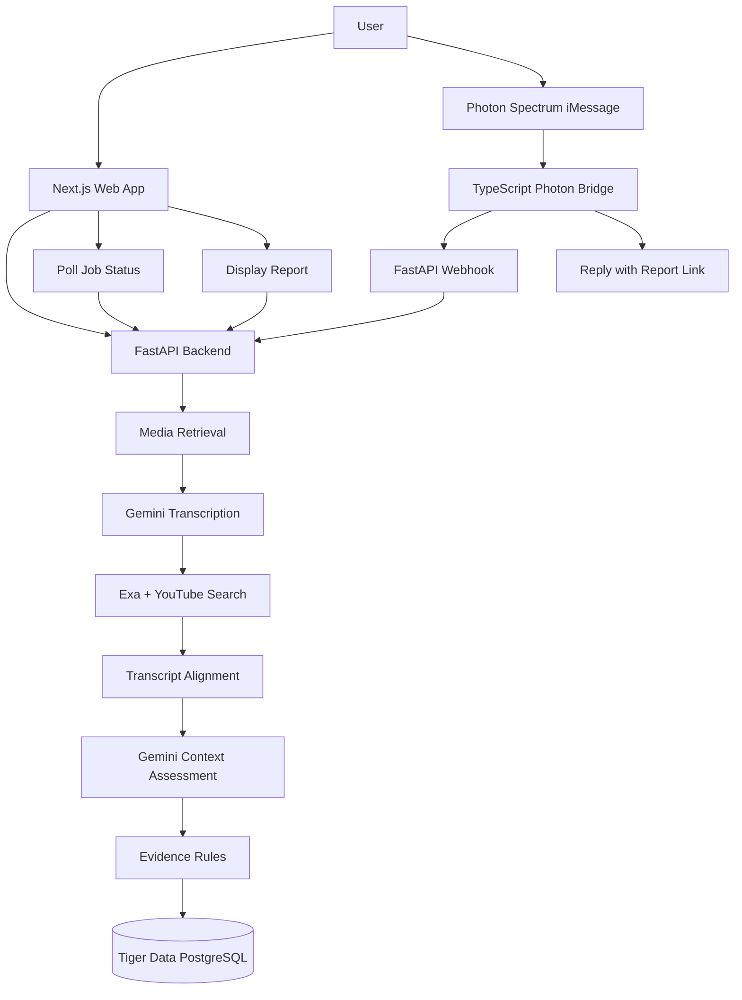

# ZoomOut
### Team Quantro @ HackNC
### Members: Abdullah Siddique, Bhrigu Uppal, Grant Andrews, Jason Kasnicki 

### Problem

ZoomOut helps people investigate viral political speech clips by finding potential longer recordings, locating matching passages, and showing what was said before and after the clip.

Submit a clip through the web app or send it through iMessage. ZoomOut searches for potential sources, aligns transcript passages, evaluates surrounding context, and generates an evidence-backed report that distinguishes verified findings from unverified leads.

**Our principle:** Show the evidence. Communicate uncertainty. Never claim more than the evidence supports.

**Live demo:** https://quantro-ten.vercel.app

---

## Table of Contents

- [Why ZoomOut?](#why-zoomout)
- [What It Does](#what-it-does)
- [How It Works](#how-it-works)
- [Technical Architecture](#technical-architecture)
- [Tech Stack](#tech-stack)
- [Key Design Decisions](#key-design-decisions)
- [Getting Started](#getting-started)
- [Environment Variables](#environment-variables)
- [API Reference](#api-reference)
- [Project Structure](#project-structure)
- [Limitations](#limitations)
- [Future Work](#future-work)
- [Team and Acknowledgments](#team-and-acknowledgments)

---

## Why ZoomOut?

Short political clips can spread rapidly without the context needed to interpret them accurately. A few seconds of speech may omit the preceding question, a qualification, or the statement that explains what a speaker meant.

Finding the original recording and manually comparing transcripts is time-consuming. ZoomOut makes that investigation easier by turning a submitted clip into a structured report with potential source recordings, matched passages, surrounding context, and explicit limitations.

ZoomOut is an investigative aid, not an automated truth detector.

## What It Does

- **Submit a clip:** Paste a link into the website or send it through the Photon-powered iMessage agent.
- **Discover potential sources:** Search for longer recordings using transcript-derived queries and post metadata.
- **Locate matching passages:** Compare transcript text to identify a matching segment and approximate its timestamp.
- **Recover context:** Examine approximately 30 seconds before and after the matched passage when sufficient source material is available.
- **Generate an evidence report:** Present source links, matched passages, timestamps, contextual analysis, and a rule-based confidence rating.
- **Access results easily:** View the full report on the web or receive its link through iMessage.

## How It Works

### End-to-End Pipeline

1. **Submission and ingestion**

   A user submits a clip URL through the website or iMessage. The backend creates or processes an analysis job.

2. **Media retrieval**

   `yt-dlp` attempts to retrieve media, while FFmpeg handles media processing. If the hosted environment cannot download a video, the pipeline can fall back to transcript-based analysis.

3. **Transcription**

   Gemini (`gemini-flash-latest`) transcribes requested media windows of up to 60 seconds and produces word-level timestamps.

4. **Source discovery**

   ZoomOut builds search queries from transcript content and available post metadata. Exa semantic search and keyword-based YouTube search identify potential source recordings.

5. **Transcript alignment**

   The `transcript_alignment` component searches candidate transcripts for distinctive word sequences matching the submitted clip, ignoring capitalization and punctuation.

6. **Context assessment**

   When a passage is matched, Gemini analyzes approximately 30 seconds of surrounding source context on either side.

7. **Evidence scoring**

   `evidence_rules_v1` evaluates the available evidence and assigns a **low**, **moderate**, or **high** confidence rating. These categories are rule-based assessments, not statistical probabilities.

8. **Report generation and storage**

   The finished report is stored in Tiger Data PostgreSQL and made available through the report endpoint.

### Architecture Diagram

## Technical Architecture

ZoomOut separates the user-facing interfaces, analysis pipeline, messaging integration, and persistent storage.

| Component | Responsibility |
|---|---|
| Next.js frontend | Accept submissions, display analysis progress, and render reports |
| FastAPI backend | Coordinate ingestion, analysis jobs, status updates, and report retrieval |
| Photon Spectrum bridge | Relay iMessage submissions to the backend and return report links |
| Gemini | Transcribe media and analyze matched passages in context |
| Exa and YouTube search | Discover candidate source recordings |
| `transcript_alignment` | Locate matching transcript passages |
| `evidence_rules_v1` | Assign rule-based evidence confidence |
| Tiger Data PostgreSQL | Persist reports and media-analysis features |

The frontend polls the backend while an analysis is running and displays a progress state such as **“Finding the source…”** until the result is ready.

## Tech Stack

| Layer | Technologies | Purpose |
|---|---|---|
| Frontend | Next.js 16, React 19, TypeScript | Web application and report interface |
| Styling and animation | Tailwind CSS 4, Framer Motion | Styling, transitions, and UI interactions |
| Frontend hosting | Vercel | Deployment of the web application |
| Backend | Python, FastAPI | API endpoints and analysis orchestration |
| Backend hosting | Render | Hosted API and processing service |
| AI analysis | Gemini (`gemini-flash-latest`) | Timestamped transcription and contextual analysis |
| Source discovery | Exa, YouTube keyword search | Semantic and keyword-based retrieval |
| Media processing | `yt-dlp`, FFmpeg | Media retrieval and processing |
| Messaging | Photon Spectrum, TypeScript | iMessage interaction and report delivery
