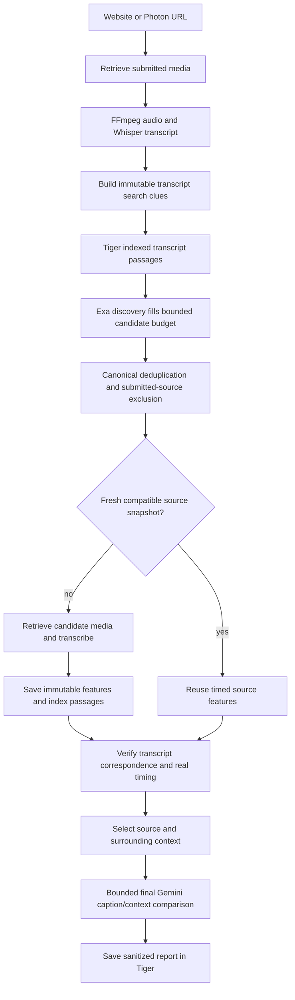

# Transcript archive and web discovery

This backend adds `SEARCH_PROVIDER=hybrid` using the existing Tiger database and
`EXA_API_KEY`. Explicit `exa`, `tiger` and other supported modes keep working.
No frontend or public v2 report/candidate fields change. No new API is required.

## Runtime behavior

- The public `search_candidates(queries, limit)` contract is unchanged. A private
  scoped context borrows the job's TigerStore and excludes canonical submitted
  identities. It restores context even on failure and does not close job storage.
- PostgreSQL searches bounded transcript passages with an expression GIN index.
  Query values are bound; canonical identities are grouped/excluded before the
  database limit. The SQLite test implementation is an AND-token subset, not
  PostgreSQL phrase/stemming parity or a production-scale substitute.
- Up to four Exa requests overlap with at most three workers. Their merge order
  remains deterministic. Exa overfetch is capped at ten results per request.
  Discovery is bounded, not an exhaustive crawl. Hybrid reserves a web slot when
  `limit > 1`; with limit one, a local hit fills the budget and warns that web was
  skipped. Cached transcript search alone does not establish a verified source.
- If hybrid discovery produces no viable aligned source, the pipeline performs
  one additional search using at most three unused or quote-relaxed clues. It
  preserves every original word, excludes previously attempted sources, and
  assesses at most two new candidates. This adds at most four Exa requests;
  there is no unbounded crawl, automatic claim rewriting or extra Gemini search.
- Unsafe discovery URLs are discarded with a warning. Provider failures are
  errors, including empty successful pages followed by quota errors. Partial
  failures with usable results remain disclosed as incomplete coverage.
- Fresh candidate snapshots avoid repeated download and Whisper work for one
  hour. Keys include canonical identity, media SHA-256, extraction options,
  provider/model settings, dependency versions and extraction-code hashes.
  Floating model names are not claimed to be pinned weight revisions. Snapshot
  reuse retains the original retrieval timestamp, warns that current URL bytes
  were not downloaded, and still runs alignment and self-source checks.
- Optional cache failures fall back to fresh retrieval or preserve fresh evidence
  with a warning. They do not turn failed discovery into a false no-match result.
- Gemini is not used for indexing, search, deduplication or deterministic alignment.
  The existing final comparison runs only after a viable source/context exists.
  Original ASR text is preserved; no semantic rewrite replaces quote evidence.
  A definitive comparison uses two requests normally, at most three with one
  evidence repair; unassessable input uses zero or one. Set
  `GEMINI_COMPARISON_MODEL=gemini-3.1-flash-lite` for the comparison-only budget
  model, without changing transcription/frame models. No expensive model
  fallback occurs. The live 3.1 Flash-Lite probe passed; the cheaper listed 2.5
  Flash-Lite returned 404 on generation for this account. Pricing checked on
  2026-10-10: $0.25/M text input, $1.50/M output for 3.1 Flash-Lite
  ([Google pricing](https://ai.google.dev/gemini-api/docs/pricing)).

## Archive and migration

`TigerStore.ensure_schema()` adds `<prefix>source_passages` and
`<prefix>source_features`, without changing existing jobs/posts/reports. The
PostgreSQL GIN index is created with the additive table. Deploy schema before
enabling `SEARCH_PROVIDER=hybrid`; standalone search does not issue schema DDL.
The existing startup schema initialization handles this on normal boot.

New ingest and cached candidate features index their genuine timed sentences.
Earlier jobs are not automatically backfilled. The streaming importer documented
in [ARCHIVE_IMPORT.md](ARCHIVE_IMPORT.md) accepts untimed published documents with
hashes/provenance. Imported timestamps stay null; recording links require
publisher-link provenance and remain discovery candidates until verified.

The importer can process a 100,000-record stream without loading it all into
memory. That is not evidence that 100,000 real recordings have been acquired or
that database throughput has been measured at that size. Current curated sources
are a small modern 2009–2025 seed plus the separately retained debate archive.

## Verification and limits

See [HYBRID_VERIFICATION.md](HYBRID_VERIFICATION.md) for actual test outputs.
Uncached acquisition, longer-video Whisper time, YouTube bot challenges, absent
captions, and provider quotas remain external latency/access constraints.
Text matching does not establish factual truth, voice identity or deepfake status.
Jeff's factual checker and any future forensic detector remain separate.

Rollback: select the previous explicit search provider and deploy the previous
backend commit. New additive archive/cache tables can remain; do not drop shared
jobs, posts or reports. Clear private cache snapshots only through an operator
procedure if a model revision or recording association is found wrong.
