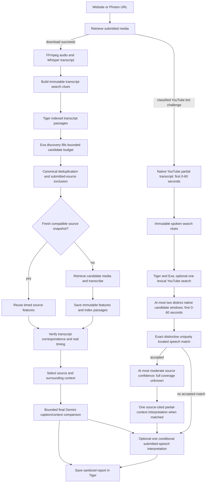

# Transcript archive, web discovery and bounded YouTube fallback

This backend adds `SEARCH_PROVIDER=hybrid` using the existing Tiger database and
`EXA_API_KEY`. Explicit `exa`, `tiger` and other supported modes keep working.
No frontend or public v2 report/candidate fields change. No new API is required.

## Runtime behavior

- The public `search_candidates(queries, limit)` contract is unchanged. A private
  scoped context borrows the job's TigerStore and excludes canonical submitted
  identities. It restores context even on failure and does not close job storage.
- PostgreSQL searches bounded transcript passages with an expression GIN index.
  Query values are bound; canonical identities are grouped/excluded before the
  database limit. The SQLite test implementation is an AND-token subset, not
  PostgreSQL phrase/stemming parity or a production-scale substitute.
- Up to four Exa requests overlap with at most three workers. Their merge order
  remains deterministic. Exa overfetch is capped at ten results per request.
  Discovery is bounded, not an exhaustive crawl. Hybrid reserves a web slot when
  `limit > 1`; with limit one, a local hit fills the budget and warns that web was
  skipped. Cached transcript search alone does not establish a verified source.
- If hybrid discovery produces no viable aligned source, the pipeline performs
  one additional search using at most three unused or quote-relaxed clues. It
  preserves every original word, excludes previously attempted sources, and
  assesses at most two new candidates. This adds at most four Exa requests;
  there is no unbounded crawl, automatic claim rewriting or extra Gemini search.
- Unsafe discovery URLs are discarded with a warning. Provider failures are
  errors, including empty successful pages followed by quota errors. Partial
  failures with usable results remain disclosed as incomplete coverage.
- Fresh candidate snapshots avoid repeated download and Whisper work for one
  hour. Keys include canonical identity, media SHA-256, extraction options,
  provider/model settings, dependency versions and extraction-code hashes.
  Floating model names are not claimed to be pinned weight revisions. Snapshot
  reuse retains the original retrieval timestamp, warns that current URL bytes
  were not downloaded, and still runs alignment and self-source checks.
- Optional cache failures fall back to fresh retrieval or preserve fresh evidence
  with a warning. They do not turn failed discovery into a false no-match result.
- Gemini is not used for indexing, search, deduplication or deterministic alignment.
  On the downloaded-media path the existing final comparison runs only after a viable source/context exists.
  Original ASR text is preserved; no semantic rewrite replaces quote evidence.
  A definitive comparison uses two requests normally, at most three with one
  evidence repair; unassessable input uses zero or one. Set
  `GEMINI_COMPARISON_MODEL=gemini-3.1-flash-lite` for the comparison-only budget
  model, without changing transcription/frame models. No expensive model
  fallback occurs. The live 3.1 Flash-Lite probe passed; the cheaper listed 2.5
  Flash-Lite returned 404 on generation for this account. Pricing checked on
  2026-10-10: $0.25/M text input, $1.50/M output for 3.1 Flash-Lite
  ([Google pricing](https://ai.google.dev/gemini-api/docs/pricing)).

## Bounded native YouTube path

A specifically classified YouTube bot-verification download block can use the
existing Gemini native YouTube input. Invalid, deleted, private, unsupported and
storage failures retain structured errors. `/ingest` still requires a real
download. This fallback creates no pretend file, media bytes, Whisper/audio
fingerprint evidence or recording duration. Native text and timestamps remain
provider estimates, with partial coverage explicitly disclosed.

The current fallback extends the earlier transcript-only baseline:

1. Request only the submitted recording's first 0–60 seconds, with a token
   preflight and bounded generation. Preserve the returned spoken words; do not
   rewrite them into an assumed claim. Public oEmbed title/uploader metadata is
   optional; uploader identity is not speaker identity and is not a caption.
2. Build bounded clues from actual speech. Search Tiger and Exa through the
   configured provider, excluding the submitted recording and duplicate links.
   An optional single lexical YouTube search complements semantic discovery.
   It is not a comprehensive web scan; discovered links are unverified leads.
3. Examine at most two distinct public YouTube candidates through independent
   native 0–60-second requests. Accept only distinctive exact normalized speech
   with a unique location in the observed source window. Repeated passages stay
   ambiguous; inaccessible candidates can be skipped with disclosed warnings.
4. Cap accepted source confidence at **moderate**. Full-clip coverage stays
   `null`, edit analysis stays `not_assessed`, and confirmed edit counts stay
   `null`. A matching recording does not establish the earliest original upload.
5. For an accepted match, make at most one cited partial-context interpretation
   call. Citations are expanded locally into supplied sentences and timestamps.
   Context assessment remains uncertain; caption assessment is uncertain or
   `not_provided` when absent. Assessment confidence stays low, rather than a
   definitive omission or misleading-caption verdict.
   Interpretation failure preserves the observed speech match.
6. When enabled, make at most one additional standalone submitted-transcript
   interpretation call before saving, including on no-match results. Its summary
   describes the actual clip without assuming political speech. Bounded title,
   caption and uploader clues are attributed metadata, not verified identities
   or events. Suggested references are not established facts. The reading uses
   validated local sentence references and short exact quotes, never internal IDs.
   Provider or validation failure retains the prior report and adds a limitation.
7. Save the sanitized report through the existing idempotent Tiger boundary.
   Completed-job retries reuse the stored summary and do not repeat the optional
   standalone call. The public schema stays unchanged.

Configuration uses existing credentials; no additional API or dependency is
required. For the already available SerpAPI lexical provider, set
`SEARCH_FALLBACK_PROVIDER=serpapi`. `SEARCH_FALLBACK_API_KEY` optionally selects
its private key; if blank, the existing `SEARCH_PROVIDER_API_KEY` is used.
Keep these in ignored local or private deployment settings. The existing Exa
key and Tiger configuration continue to serve the primary discovery path.
`SUBMITTED_INTERPRETATION_ENABLED=true` enables the optional standalone call
(`false` or unset disables it). `.env.example` enables it without containing a
credential. The existing `GEMINI_COMPARISON_MODEL` selects the budget text model.

This path establishes neither factual truth, deceptive intent, speaker identity,
deepfake status nor physical splicing. A no-match can reflect unobserved content
outside the first minute, discovery limits or access failures; it does not prove
there is no source. Native YouTube access and quotas remain external constraints.

## Archive and migration

`TigerStore.ensure_schema()` adds `<prefix>source_passages` and
`<prefix>source_features`, without changing existing jobs/posts/reports. The
PostgreSQL GIN index is created with the additive table. Deploy schema before
enabling `SEARCH_PROVIDER=hybrid`; standalone search does not issue schema DDL.
The existing startup schema initialization handles this on normal boot.

New ingest and cached candidate features index their genuine timed sentences.
Earlier jobs are not automatically backfilled. The streaming importer documented
in [ARCHIVE_IMPORT.md](ARCHIVE_IMPORT.md) accepts untimed published documents with
hashes/provenance. Imported timestamps stay null; recording links require
publisher-link provenance and remain discovery candidates until verified.

The importer can process a 100,000-record stream without loading it all into
memory. That is not evidence that 100,000 real recordings have been acquired or
that database throughput has been measured at that size. Current curated sources
are a small modern 2009–2025 seed plus the separately retained debate archive.

## Verification and limits

See [HYBRID_VERIFICATION.md](HYBRID_VERIFICATION.md) for actual test outputs.
The initial focused run for the native-source extension passed **371 tests with
one skip**; the standalone interpretation component passed **30 focused tests**.
A later local diagnostic using saved submitted speech completed in **11.37
seconds**, accepted candidate `pJvRUL81ZU8` with one speech match and produced one
source-cited finding. This is a bounded diagnostic, not an independently checked
transcript/timestamp accuracy result, fresh full-pipeline timing, or hosted
deployment proof. A new final-suite or deployment pass is not claimed here.
Uncached acquisition, longer-video Whisper time, YouTube bot challenges, absent
captions, and provider quotas remain external latency/access constraints.
Text matching does not establish factual truth, voice identity or deepfake status.
Jeff's factual checker and any future forensic detector remain separate.

Rollback: select the previous explicit search provider and deploy the previous
backend commit. New additive archive/cache tables can remain; do not drop shared
jobs, posts or reports. Clear private cache snapshots only through an operator
procedure if a model revision or recording association is found wrong.

## 2026-10-10 contextual-source and report readability update

Matching speech alone no longer qualifies a recording as the contextual source.
Both downloaded and transcript-only candidates must contain additional observed
speech outside aligned passages and within the context window. The conservative
eligibility check requires four words and two new informative words, preserves
negation, and excludes repeated speech and subscription outros. It does not
establish originality, factual accuracy, or a physical edit. Duplicate-only
results retain no verified source; another candidate is checked within the
existing two-candidate remote budget.

The optional lexical query now seeks fuller recordings using an exact spoken
quote. Unverified full-recording titles and duration hints prioritize inspection,
never supply verified duration or prove context. Context outside the inspected
windows can still be missed.

Reports show safe fixed-host YouTube embeds when downloaded playback is absent,
with an always-visible original link and a visible unavailable state. Analysis
uses Takeaways, What this means, Reliability, and cited Evidence, readable notes,
plain body text, and expandable long interpretations. Model speculation remains
unverified. The public schema and idempotent Tiger boundary are unchanged. Older
saved reports remain historical results; use a new job to apply the new gate.

Verified locally: 375 backend regression tests and 73 frontend tests passed.
Frontend TypeScript and scoped ESLint passed. Hosted rollout is a separate step;
these results do not establish population accuracy or recovery of an original
full-length recording.

## 2026-10-10 content-first interpretation and multiple source leads

The submitted interpretation now combines actual speech with bounded title,
caption, platform and uploader metadata in the existing one-call budget. It
explains the action or claim in plain language without assuming every clip is a
political speech. Metadata identities and settings must be attributed. A failed
source match does not suppress the submitted-clip interpretation.

Discovery keeps the first actual-speech query, uses a bounded joint metadata and
speech locator in the primary query budget, and preserves short numeric clues.
The optional lexical query distinguishes full visits/footage from speeches.
Up to five safe, deduplicated YouTube leads are exposed with titles, links and
optional previews, including weaker candidates. They remain explicitly
unverified and separate from the verified source. Actual candidate assessment
remains capped at two recordings; no numeric match probability is invented.

Reports place the concrete reading in Takeaways, attributed post clues in What
this means, source/context status in Reliability, and exact cited words in
Evidence. Older saved summaries remain historical. Reanalyze with a new job to
produce the updated interpretation.

Verified locally: 446 backend regression tests, 81 frontend tests, full frontend
ESLint, TypeScript and the production build passed. Universal original recovery,
Instagram/TikTok access, later source windows, physical edits and factual or
intent judgments remain unverified. Hosted rollout is a separate verification.

### Publisher-linked recording discovery

Exa now requests at most ten page links in each existing search request. Strict
YouTube and no-cookie embed links become deduplicated candidate recordings with
publisher-page provenance. Actual recording search metadata wins over page clues;
page author/date are never assigned to the linked recording. No arbitrary local
HTTP fetch, new dependency or extra Exa endpoint request is introduced.

Verified: 171 source/Exa/hybrid/discovery regression tests passed after this
addition. One live bounded Exa request accepted the links payload with HTTP200,
but returned no YouTube page links for that particular query. Exa page-link
coverage does not guarantee iframe discovery. The official Obama source was
independently located in the government archive; automatic discovery and timed
alignment remain separate tests.

### Final discovery ranking correction

A hosted regression exposed generic greeting queries and unrelated video-page
recommendations. Distinctive actual speech now drives the first provider request;
metadata relevance precedes longer-recording hints. The optional lexical query
uses compact metadata and exact speech without restrictive full-video OR labels,
superseding the scene-specific query description above. YouTube recommendations
are excluded from publisher-link extraction. Helpful supplied names and venues
must appear as attributed post context in the standalone overview. Final combined
backend regression suite:484passed. Hosted source recovery remains independently
verified after deployment; the initial live run missed the official Obama source.

### Caption location and event relevance correction

The first-minute-only source check missed excerpts later in a correctly found
speech. Existing SerpAPI credentials now support one bounded timed-caption lookup
per candidate. Unique eight-word speech fingerprints locate a short window
anywhere within the supported 24-hour start range. Caption cues contain start
markers only; end times and full recording duration are never inferred. Gemini
then observes that requested 60-second video window independently. Exact speech
alignment and additional surrounding speech are still required for a match.
Explicit YouTube offsets are preserved and validated, and returned timestamps
must be absolute original-video times within the requested window.

Named event metadata now leads the search query budget. Candidate ranking uses
distinct word overlap and leading-name anchors so generic recipe videos do not
consume the limited verification slots. Unknown metadata stays unknown, and
distinctive speech can rescue a source with differently labeled metadata. This
heuristic can miss unusual titles and does not verify identity or originality.

Verified locally: 595 affected backend tests passed. A live SerpAPI response for
C-SPAN recording eWynt87PaJ0 returned 137 caption cues, including speech after
13 minutes; the submitted short clip had no captions available. Caption location
does not increase the two-candidate Gemini generation budget. Hosted matching
is checked separately after deployment. No new API key or dependency is needed.
When primary search is Exa, caption location requires the explicit existing
`SEARCH_FALLBACK_PROVIDER=serpapi` and `SEARCH_FALLBACK_API_KEY` pair. Exa's
primary key is never sent to SerpAPI. Without that pair, caption lookup is
skipped and only the initial native window is available.

The first hosted DNC regression located speech but rejected the source because
the densest cue cluster was inside the submitted excerpt, leaving no new
context. Location now subtracts the submitted sentence's position and requests
30 seconds before the estimated clip beginning. Those coarse estimates select
a window only and never become alignment evidence. A live independent window
at 726 seconds contained preceding literacy, prescription-cost and civil-liberty
examples plus matching speech, and passed the additional-context gate.
The gate also recognizes substantive observed prefix/suffix text when the
provider groups it into the same sentence as the match. Internal transcription
differences, copied speech and boilerplate do not count. No word timestamps are
invented. Final affected regression suite: 609 passed; Ruff and scoped mypy
passed.

Hosted result on backend175d7c0: yJzjyYL8l5Y matched C-SPAN eWynt87PaJ0
at the located context window beginning726seconds. The end-to-end run took
18.821seconds; analysis and saved-report GET returned200. Eight checks passed
and the Vercel report rendered both videos, both transcripts and three cited
observations. Match confidence is moderate; semantic assessment is uncertain
with low confidence. No earliest-upload, full-context or accuracy guarantee
is implied. Report: report_job_obama_dnc_locator_20261010_v2.
